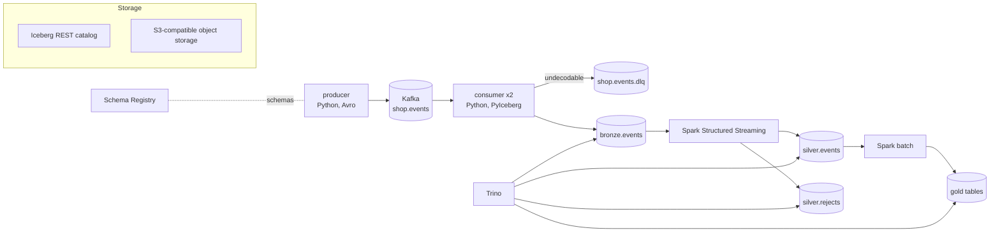

# kafka-streaming-lakehouse

> Kafka end to end on a laptop: Python producers and consumers with Avro and Schema Registry,
> landing events in an Apache Iceberg lakehouse (bronze, silver, gold) that Trino queries.

A seeded generator sends synthetic e-commerce events (page views, cart adds, orders, payments) to
Kafka, with duplicates, late events, malformed records and contract violations mixed in on
purpose. Each layer handles one of those problems, and a check reconciles every layer with what
the producer says it sent.

| Layer | Table or topic | What it holds |
| --- | --- | --- |
| Source | `lakestream produce` | Avro `ShopEvent` records and a JSON run manifest (what was sent, what each layer must end up with) |
| Kafka | `shop.events` (6 partitions), `shop.events.dlq` | the raw stream; records that cannot be decoded go to the DLQ with their original bytes |
| Bronze | `lake.bronze.events` | every decodable record with its Kafka coordinates, appended by a two-replica Python consumer group (PyIceberg) |
| Silver | `lake.silver.events`, `lake.silver.rejects` | valid events deduplicated by `event_id` (Spark Structured Streaming), and contract violations with the reason |
| Gold | `lake.gold.events_per_minute`, `lake.gold.revenue_5min`, `lake.gold.user_sessions` | event-time aggregates recomputed in batch by Spark |
| Trino | catalog `lake` | SQL over every table, including snapshot metadata and time travel |

## Architecture



All tables are Iceberg on S3-compatible object storage (RustFS) behind an Iceberg REST catalog,
and everything runs in Docker Compose. Design notes are in [docs/PLAN.md](docs/PLAN.md) and the
reasons behind each choice in [docs/DECISIONS.md](docs/DECISIONS.md).

## Quickstart

Prerequisites: Docker with Compose v2, `make` and `bash`. Give Docker about 8 GB of memory: the
long-running services take about 4.7 GB, and a Spark job adds 2 GB while it runs. Host ports are
bound to 127.0.0.1 in the 1xxxx range (Trino on 18080); change them in `.env` (copy
`.env.example`).

```bash
make demo
```

`make demo` (`scripts/demo.sh`) starts from fresh volumes and runs:

1. `docker compose up --wait`: Kafka, Schema Registry, object storage, the Iceberg REST catalog,
   two consumers and Trino;
2. the producer with seed 42, which writes the manifest to `/runs/run1.json`;
3. `lag --wait`, until the consumer group has committed every offset;
4. the silver stream (available-now) and the gold recompute;
5. `lakestream check`, which compares every layer with the manifest through Trino and reads the
   DLQ from Kafka, then exits 1 on any mismatch;
6. `maintain` (compaction, manifest rewrite, snapshot expiry), then the same check again.

Event time comes from a fixed synthetic base, so the same seed gives the same gold tables on
every run. When you are done, `make down` removes the stack and its volumes.

## Query it

Open the Trino CLI inside the container:

```bash
docker compose exec trino trino --catalog lake
```

Row counts per layer:

```sql
SELECT 'bronze' AS layer, count(*) AS row_count FROM bronze.events
UNION ALL SELECT 'silver', count(*) FROM silver.events
UNION ALL SELECT 'rejects', count(*) FROM silver.rejects
UNION ALL SELECT 'sessions', count(*) FROM gold.user_sessions;
```

Why records were rejected:

```sql
SELECT reject_reason, count(*) AS n
FROM silver.rejects
GROUP BY reject_reason
ORDER BY n DESC;
```

Late data: events that reached their Kafka partition after an event with a later event time. They
still count in the gold window of their own event time.

```sql
SELECT event_id, kafka_partition, kafka_offset, event_time, newest_before
FROM (
  SELECT *,
         max(event_time) OVER (
           PARTITION BY kafka_partition ORDER BY kafka_offset
           ROWS BETWEEN UNBOUNDED PRECEDING AND 1 PRECEDING
         ) AS newest_before
  FROM silver.events
)
WHERE event_time < newest_before
ORDER BY kafka_partition, kafka_offset;
```

Session funnel:

```sql
SELECT count(*) AS sessions,
       count_if(reached_cart) AS reached_cart,
       count_if(reached_order) AS reached_order,
       count_if(reached_payment) AS reached_payment,
       sum(revenue) AS revenue
FROM gold.user_sessions;
```

Bronze history: each consumer append records its Kafka offsets in the snapshot summary.

```sql
SELECT snapshot_id, committed_at, operation,
       element_at(summary, 'ingest.records') AS records,
       element_at(summary, 'ingest.offsets') AS offsets
FROM bronze."events$snapshots"
ORDER BY committed_at;
```

Time travel: bronze as of one of those snapshots (paste a `snapshot_id` from the query above).

```sql
SELECT count(*) FROM bronze.events FOR VERSION AS OF <snapshot_id>;
```

## Make targets

| Target | What it does |
| --- | --- |
| `make demo` | the whole run above, from fresh volumes |
| `make up` / `make down` | start the stack and wait until it is healthy / remove it with its volumes |
| `make produce` | one producer run (`ARGS="..."` overrides the options) |
| `make lag` | wait until the consumer group has caught up |
| `make silver` / `make gold` | the Spark silver stream (available-now) / the gold recompute |
| `make maintain` | compaction and snapshot expiry (`MAINTAIN_ARGS="..."`) |
| `make check` | the end-to-end check (`MANIFESTS="--manifest /runs/run1.json"`) |
| `make ui` | Kafka UI on http://127.0.0.1:18090 |
| `make lint` / `make test-fast` | ruff and mypy / unit tests, no stack needed |
| `make test-spark` | Spark tests (Linux, WSL or CI) |
| `make test-integration` | integration tests against the running stack |

## Status

The project ships in phases, one pull request each: compose and producer, consumer and bronze,
Spark silver and gold, Trino and the end-to-end check (this one). Still to come: schema evolution
with a DLQ walkthrough, and CI.

## Related

Sibling project: [cdc-streaming-demo](https://github.com/emanuel-luis/cdc-streaming-demo)
(Debezium change data capture into Delta Lake).

## License

MIT
